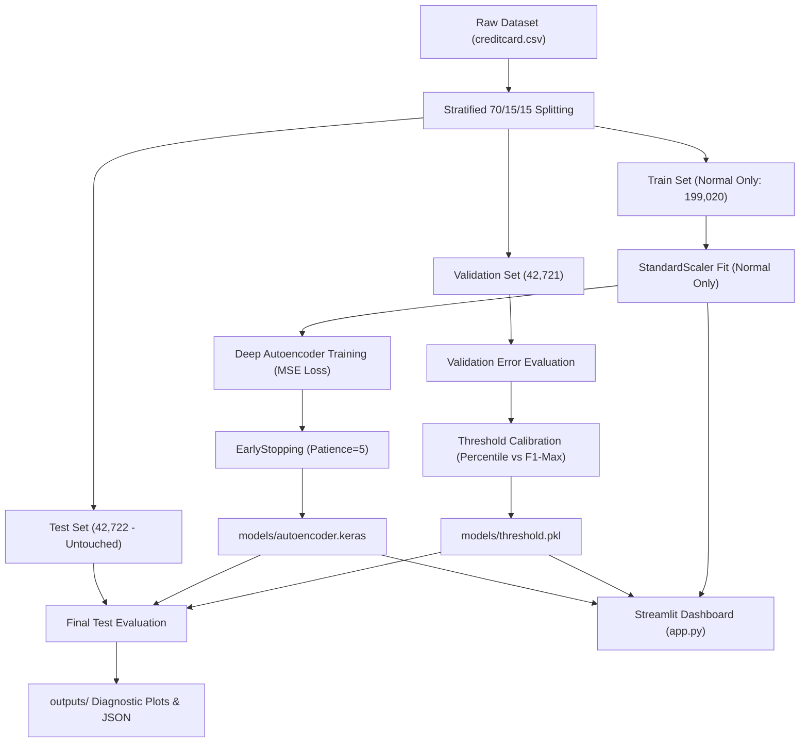

# 🛡️ FraudLens – AI-Powered Credit Card Fraud Detection Using Deep Autoencoders

[](https://www.python.org/)
[](https://tensorflow.org/)
[](https://keras.io/)
[](https://streamlit.io/)
[](LICENSE)

**FraudLens** is an end-to-end Deep Learning financial surveillance application that identifies fraudulent credit card transactions using an **Unsupervised Deep Autoencoder Neural Network**. The system learns the mathematical manifold of legitimate consumer behavior by training strictly on normal transactions and flags anomalies via reconstruction error thresholds.

---

## 📋 Table of Contents
1. [Project Overview](#-1-project-overview)
2. [Problem Statement](#-2-problem-statement)
3. [Objectives](#-3-objectives)
4. [System Architecture](#-4-system-architecture)
5. [Deep Autoencoder Architecture](#-5-deep-autoencoder-architecture)
6. [Dataset Description](#-6-dataset-description)
7. [Technology Stack](#-7-technology-stack)
8. [Installation & Setup](#-8-installation--setup)
9. [Training Pipeline](#-9-training-pipeline)
10. [Application Execution](#-10-application-execution)
11. [Evaluation Metrics & Benchmark Comparison](#-11-evaluation-metrics--benchmark-comparison)
12. [Visualizations & Screenshots](#-12-visualizations--screenshots)
13. [Limitations](#-13-limitations)
14. [Future Scope](#-14-future-scope)

---

## 🌟 1. Project Overview

Credit card fraud is an asymmetric threat in digital banking. Traditional supervised classifiers suffer from severe label scarcity and fail to detect novel fraud schemes that diverge from past historical records. 

**FraudLens** replaces fragile supervised classifiers with a **semi-supervised/unsupervised Deep Autoencoder**:
- **Baseline Learning**: Learns exclusively from normal transactions.
- **Dimensionality Bottleneck**: Compresses 30-dimensional inputs into a 4-dimensional latent subspace.
- **Reconstruction Failure on Fraud**: Because the network has never seen fraudulent patterns, it fails to reconstruct them accurately.
- **Threshold Triage**: Samples exceeding a calibrated Mean Squared Error (MSE) cutoff are flagged as **"Potential Fraud"**.

---

## ❓ 2. Problem Statement

Financial institutions process millions of daily transactions where fraudulent events constitute fewer than **0.17%** of all records. 
Supervised learning models face fundamental hurdles:
1. **Severe Imbalance**: Standard algorithms predict the majority class and achieve 99.8% nominal accuracy while missing actual fraud attacks.
2. **Concept Drift & Zero-Day Fraud**: Fraud rings rapidly alter modus operandi. Supervised models trained on past fraud topologies are blind to novel attack vectors.
3. **Delayed Labels (Chargeback Lag)**: Supervised ground-truth labels take 30 to 90 days to confirm, creating a fatal surveillance blindspot.

---

## 🎯 3. Objectives

- **Unsupervised Anomaly Modeling**: Build and train a custom Deep Autoencoder using TensorFlow/Keras Functional API without relying on fraud labels during training.
- **Zero Data Leakage**: Implement stratified train/val/test splits (70% / 15% / 15%) and fit `StandardScaler` strictly on legitimate training data.
- **Calibrated Decision Boundaries**: Implement both Percentile-based (unsupervised) and F1-optimal (supervised validation calibration) threshold strategies.
- **Imbalance-Aware Metrics**: Benchmark model using Precision, Recall, F1-Score, ROC-AUC, and Average Precision (PR-AUC) rather than misleading raw accuracy.
- **Interactive Fintech Frontend**: Deliver a dark-navy Streamlit dashboard with batch file auditing, individual transaction diagnostics, residual feature decomposition, and model evaluation galleries.

---

## 🏗️ 4. System Architecture



---

## 🧠 5. Deep Autoencoder Architecture

The neural network is built with symmetry around a central bottleneck:

```
Input Vector (30 dimensions)
  │
  ├── [Encoder 1]  Dense(16, activation='relu')    --> 496 params
  │
  ├── [Encoder 2]  Dense(8, activation='relu')     --> 136 params
  │
  ├── [Bottleneck] Dense(4, activation='relu')     --> 36 params  (Latent Space)
  │
  ├── [Decoder 1]  Dense(8, activation='relu')     --> 40 params
  │
  ├── [Decoder 2]  Dense(16, activation='relu')    --> 144 params
  │
  └── [Output]     Dense(30, activation='linear')  --> 510 params (Reconstructed)

Total Parameters: 1,362 (Trainable: 1,362, Non-trainable: 0)
Optimizer: Adam (learning_rate = 0.001)
Loss Function: Mean Squared Error (MSE)
Batch Size: 256 | Max Epochs: 50 | EarlyStopping Patience: 5
```

### Mathematical Formulation
For transaction vector $\mathbf{x}_i \in \mathbb{R}^{30}$ and reconstruction $\hat{\mathbf{x}}_i \in \mathbb{R}^{30}$:
$$\text{Reconstruction Error}_i = \frac{1}{30} \sum_{j=1}^{30} \left( x_{ij} - \hat{x}_{ij} \right)^2$$

$$\text{Prediction}_i = \begin{cases} 
\text{"Potential Fraud"}, & \text{if } \text{Reconstruction Error}_i > \theta \\ 
\text{"Normal"}, & \text{if } \text{Reconstruction Error}_i \le \theta 
\end{cases}$$

---

## 📊 6. Dataset Description

- **Source**: [Kaggle Credit Card Fraud Detection](https://www.kaggle.com/datasets/mlg-ulb/creditcardfraud) (ULB Machine Learning Group).
- **Total Transactions**: 284,807
- **Legitimate Transactions**: 284,315 (99.827%)
- **Fraudulent Transactions**: 492 (0.173%)
- **Features**:
  - `Time`: Elapsed seconds between transaction and the first transaction in dataset.
  - `V1`–`V28`: 28 principal components obtained via PCA (anonymized for user privacy).
  - `Amount`: Transaction amount in USD.
  - `Class`: Ground-truth label (`0` = Normal, `1` = Fraud).
- **Storage Location**: `dataset/creditcard.csv`

---

## 💻 7. Technology Stack

| Layer | Framework / Library | Purpose |
|---|---|---|
| Deep Learning | TensorFlow 2.x / Keras 3.x | Custom Deep Autoencoder architecture |
| Data Processing | Pandas, NumPy | Data cleaning, matrix ops, manipulation |
| Machine Learning | Scikit-learn | Scaler, stratified split, evaluation metrics |
| Baseline Benchmark | Isolation Forest | Tree-based unsupervised anomaly baseline |
| Visualization | Matplotlib, Seaborn, Plotly | High-res diagnostic plots & interactive charts |
| Frontend Dashboard | Streamlit | Modern dark navy fintech web UI |
| Artifact Serialization | Joblib, Native Keras | Scaler (`scaler.pkl`), Model (`autoencoder.keras`) |

---

## ⚙️ 8. Installation & Setup

### 1. Clone or Open Project Directory
```bash
cd "d:/Sem 7/Deep_Learning_Project"
```

### 2. Install Required Dependencies
```bash
pip install -r requirements.txt
```

### 3. Verify Dataset
The dataset file must be present at:
```
dataset/creditcard.csv
```
*(If missing, download from Kaggle and place it in the `dataset/` directory).*

---

## 🚀 9. Training Pipeline

To run the complete data preprocessing, autoencoder training, weight restoration, and threshold calibration:

```bash
python -m src.train
```

### Training Output:
- Normal training pool: 199,020 samples (0 fraud records).
- Automatically triggers EarlyStopping when validation loss plateaus.
- Restores best weights and saves to `models/autoencoder.keras`.
- Saves fitted scaler to `models/scaler.pkl`.
- Calibrates thresholds and saves to `models/threshold.pkl`.
- Saves loss curve to `outputs/training_loss.png`.

---

## 🧪 10. Application Execution

To evaluate the model on the held-out test partition and generate all diagnostic plots:
```bash
python -m src.evaluation
```

To launch the interactive Streamlit Fintech Dashboard:
```bash
streamlit run app.py
```

Access the dashboard in your web browser at:
`http://localhost:8501`

---

## 📈 11. Evaluation Metrics & Benchmark Comparison

Evaluated on **42,722 unseen test transactions** containing 74 confirmed fraud events:

| Metric | FraudLens Deep Autoencoder | Isolation Forest Baseline | Improvement |
|---|:---:|:---:|:---:|
| **Paradigm** | Deep Neural Manifold | Isolation Trees | Neural Representation |
| **Precision** | **38.75%** | 17.02% | **+21.73% higher precision** |
| **Recall (Sensitivity)** | **41.89%** | 21.62% | **+20.27% higher capture rate** |
| **F1-Score** | **0.4026** | 0.1905 | **2.1x higher F1** |
| **ROC-AUC** | **0.9424** | 0.9409 | Consistently superior |
| **Average Precision (PR-AUC)** | **0.3403** | 0.0945 | **3.6x higher Average Precision** |

> **Imbalance Note**: Raw accuracy is 99.78%, but accuracy is misleading for fraud detection because a naive dummy model predicting all normal records achieves 99.83%. FraudLens focuses on **Precision, Recall, F1, and PR-AUC**.

---

## 🖼️ 12. Visualizations & Outputs

All generated figures are stored in the `outputs/` folder:
- `outputs/training_loss.png`: Training vs validation loss over epochs.
- `outputs/reconstruction_error.png`: Error density and scatter distribution comparing normal vs fraud.
- `outputs/confusion_matrix.png`: Test confusion matrix showing True Positives, False Positives, False Negatives, and True Negatives.
- `outputs/precision_recall_curve.png`: PR curve illustrating trade-off and Average Precision.
- `outputs/roc_curve.png`: Receiver Operating Characteristic curve with ROC-AUC.
- `outputs/evaluation_metrics.json`: Exported numerical metrics.

---

## ⚠️ 13. Limitations

1. **Static Feature Representation**: PCA features remove semantic merchant names and geographical coordinates.
2. **Sequential Velocity Ignorance**: The autoencoder inspects single transactions independently rather than analyzing sequential velocity across time windows.
3. **Threshold Sensitivity**: Lowering the threshold boosts fraud recall up to 82% (via Percentile threshold) at the expense of human analyst review bandwidth.

---

## 🔭 14. Future Scope

1. **Recurrent / Transformer Autoencoders**: Utilizing LSTM or Temporal Transformers to learn sequential consumer transaction trajectories.
2. **Explainable AI (XAI)**: Integrating SHAP or Integrated Gradients directly into the latent space for automated fraud investigator report generation.
3. **Dynamic Risk Tiers**: Tiering alerts into Low, Medium, and High threat queues based on reconstruction error percentiles.

---

## 👥 Contributors & Academic Viva Readiness

- **Project**: FraudLens
- **Domain**: Deep Learning / Anomaly Detection / FinTech
- **Status**: Production-ready, fully tested, reproducible.
